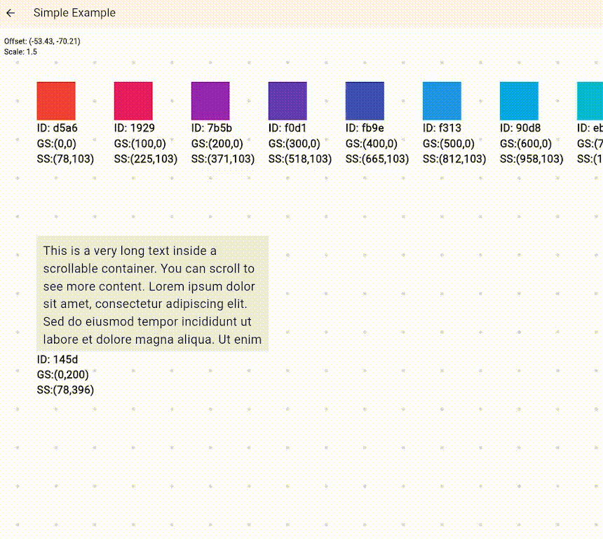

# infinite_lazy_grid

Infinite zoomable, pannable 2D canvas using spatial hash for only rendering what's visible.

Example: https://infinite-lazy-grid.pages.dev/

<p align='center'>
    
</p>

## Quick Start

```dart
import 'package:flutter/material.dart';
import 'package:infinite_lazy_grid/infinite_lazy_grid.dart';

class DemoCanvas extends StatefulWidget {
  const DemoCanvas({super.key});
  @override
  State<DemoCanvas> createState() => _DemoCanvasState();
}

class _DemoCanvasState extends State<DemoCanvas> {
  // all interactions go through the controller
  final controller = LazyCanvasController(
    background: const DotGridBackground(),
    debug: true, // wraps each child with debug info visible on screen (positions, id)
  );

  @override
  void initState() {
    super.initState();
    // Add some sample nodes in a grid
    for (int i = 0; i < 50; i++) {
      controller.addChild(
        Offset((i % 10) * 140.0, (i ~/ 10) * 140.0),
        Container(
          width: 100,
          height: 100,
          color: Colors.primaries[i % Colors.primaries.length],
          alignment: Alignment.center,
          child: Text('${i + 1}', style: const TextStyle(color: Colors.white)),
        ),
      );
    }
  }

  @override
  Widget build(BuildContext ctx) {
    return Scaffold(
      appBar: AppBar(title: const Text('infinite_lazy_grid')),
      // pass the controller to the LazyCanvas widget
      body: LazyCanvas(controller: controller),
    );
  }
}
```

## Migrating from 1.x

Upgrade to `infinite_lazy_grid: ^2.0.0`:

- `updatePosition(id, position)` → `update(id, position: position)`.
- `updateChildWidget(id, widget)` → `update(id, widget: widget)`.
- `update()` now returns a boolean.
- Replace `buildCacheExtent`/`setBuildCacheExtent` with `buildExtentMultiplier` at construction. Its default remains `2`, which gives twice the viewport height; horizontal padding also has a 200 logical screen pixel minimum per side by default.
- `minHorizontalBuildPadding` is a final `double` constructor parameter, defaulting to `200` logical screen pixels per side. It must be finite and nonnegative or construction throws `ArgumentError`. Set it to `0` to opt out of the minimum.
- `ChildInfo` is now read-only ( as it should've been ). Its constructor needs `rotation` and nullable `childSize`. Its `child` is unwrapped.

## Usage

### Adding/Removing children

```dart
// one child, returns its id which is just a uuid string
CanvasChildId oneChild = controller.addChild(
  const Offset(500, 1200),
  const Icon(Icons.place, size: 32),
);

// with custom widget
List<CanvasChildId> batchAdd = controller.addChildren([
  CanvasChildArgs(position: const Offset(0, 0), widget: const Text('Origin')),
  CanvasChildArgs(position: const Offset(800, 200), widget: const Icon(Icons.star)),
]);

// remove one by Id
controller.removeChild(oneChild);

// remove all
controller.clear();
```

### Arrange children

`childOrder` is an immutable back-to-front snapshot, including culled children.
Arrange moves IDs as one ordered bundle, ignoring duplicates.

```dart
final targets = [firstId, secondId];
controller.canArrange(targets, CanvasArrange.forward); // Check availability.
controller.bringForward(targets); // Cross the nearest overlap above the bundle.
controller.sendBackward(targets); // Cross the nearest overlap below the bundle.
controller.bringToFront(targets);
controller.sendToBack(targets);
```

Commands validate all IDs, return whether order changed, and notify once on change.
`canArrange` only checks. Forward/backward use rotated footprints and require
supplied or cached sizes, throwing `StateError` if unknown. Front/back need no sizes.

### Query overlapping children

```dart
final ids = controller.overlappingChildren(
  const Rect.fromLTWH(100, 200, 300, 150), // Canvas/grid coordinates.
);
```

Returns an immutable back-to-front snapshot using rotated layout rectangles,
including cached measurements of culled children. Unknown or empty sizes and
edge-only contact are excluded. Empty query rectangles return no IDs; nonfinite
bounds throw `ArgumentError`. The query does not build children, change order,
or notify listeners.

### Focus / center

All of these animate by default (`duration` optional, `animate: false` to jump).

```dart
// child specific
controller.focusOnChild(id);                                   // keep scale
controller.focusOnChild(id, scalingMode: ScalingMode.resetScale);
controller.focusOnChild(id, scalingMode: ScalingMode.fitInViewport, preferredHorizontalMargin: 16); // fit width and height

// absolute position in grid space
controller.centerOnGridOffset(const Offset(0, 0));

// absolute position in screen space
controller.centerOnScreenOffset(const Offset(200, 150));
```

### Zoom & animate

Set optional, read-only zoom limits when creating the controller:

```dart
final controller = LazyCanvasController(minScale: 0.25, maxScale: 4);
```

Omitted bounds are unrestricted. Supplied bounds must be finite and positive,
with `minScale <= maxScale`. The initial scale of `1`, gestures, zoom commands,
focus commands, and animations are clamped to the limits. Focus still centers
the child, but a minimum scale may prevent it from fitting fully in the viewport.

```dart
controller.updateScalebyDelta(0.2);      // zoom in
controller.updateScalebyDelta(-0.2);     // zoom out
// animate to position on grid
await controller.animateToOffsetAndScale(
  offset: const Offset(1200, 300),
  scale: 2.0,
  duration: const Duration(milliseconds: 400),
);
```

Drag scrolling has inertia by default. Set `inertiaEnabled: false` to disable
it, or adjust `inertiaFrictionCoefficient` to tune how quickly it settles.

### Input and viewport overlays

Touch uses Flutter's scale gesture recognizer: one finger pans and two fingers
pan and pinch-zoom. Touch gestures participate in Flutter's normal gesture
arena; `LazyCanvas` has no two-finger takeover mode or touch-ownership callback.
Stylus and inverted-stylus pointers are excluded from the canvas scale
recognizer, so child tools can handle them.

Mouse dragging pans with the primary button by default. Configure the accepted
buttons with `mousePanButtons`, for example:

```dart
LazyCanvas(
  controller: controller,
  mousePanButtons: kSecondaryMouseButton | kMiddleMouseButton,
)
```

Trackpad pan and zoom use Flutter's pointer pan/zoom gestures. A vertical wheel
scroll pans the canvas; Ctrl+wheel zooms around the pointer. A nested child
scrollable can consume wheel input instead of the canvas. To replace the
canvas's default vertical wheel scrolling, provide `onPointerScroll`; it
receives the controller and vertical delta:

```dart
onPointerScroll: (controller, delta) => controller.scrollBy(delta * 2),
```

Use `viewportBuilder` to put floating object controls in the same gesture
region. An overlay outside `LazyCanvas` will not contribute touches:

```dart
viewportBuilder: (context, viewport) => Overlay.wrap(
  child: Stack(children: [viewport, objectControls]),
),
```

Keep the supplied viewport at the region's origin and original size. A local
`Overlay` also keeps descendant overlay portals in that gesture region.

The first valid touch down stops existing viewport animation. Call
`controller.stopAnimation()` to stop inertia or an animated transition
explicitly without changing the current viewport.

### Background options

```dart
background: const NoBackground();
background: const SingleColorBackround(Colors.white);
background: const DotGridBackground(spacing: 60, size: 2.0);
```

All of these implement abstract class `CanvasBackground` so you can add your own.

### Render callbacks

```dart
LazyCanvasController(
  onWidgetEnteredRender: (id) { /* do something */ },
  onWidgetExitedRender: (id) { /* do something else */ },
);
```

### Widget updates

Since the args aren't directly available for you to place in the build tree, child rebuilds can be handled in three ways:

1. Stateful widget child: Child handles its own updates but state is lost when unmounted.
2. Manual update: `update(id, widget: newWidget)`.
3. Child listens to external state: Some `Listenable` or a state management library like Provider, etc., that rebuilds the child when data changes.

`getInfo(id)` returns an immutable snapshot of a child's position, widget and supplied or last-measured size, even when culled.

`update(id, position: position, childSize: size)` can update geometry too. Supplied fields apply together; omitted or null fields stay unchanged. Returns whether anything changed.

`update(id, rotation: angle)` rotates clockwise in radians around the layout center. `addChild` and `CanvasChildArgs` also accept `rotation` (default `0`); position and layout size stay unchanged.

### Size-based culling

Children with a known size are culled using their rotated, conservative axis-aligned layout bounds. The bounds include layout only, not paint overflow such as shadows. The controller uses a supplied `childSize` or a size measured during normal layout. Measured sizes remain cached after culling; update a child's geometry with `update(...)` if it changes while culled.

Children with unknown or empty sizes are discovered by their origin. A wide child with an unknown size can be missed on first approach until its origin enters the build region and normal layout measures it. Supplying `childSize` avoids this gap when it matches the actual layout. Culling does not cause extra measurement. `focusOnChild` keeps its existing offstage measurement behavior when it needs a size.

`minHorizontalBuildPadding` sets the minimum horizontal culling padding in logical screen pixels per side. It defaults to `200`, must be finite and nonnegative, and throws `ArgumentError` otherwise. Pass `minHorizontalBuildPadding: 0` to disable the minimum and use only `buildExtentMultiplier`.

## Example

See `example/` directory (Simple Example, Build Counts Example, Widget State Updates Example, Render Callbacks Example).
